# tripcurve

tripcurve is a command-line checker. It reads the files of a repository (Kubernetes manifests, container arguments, Node and Python server settings, Terraform, SAM and CloudFormation) and checks that the timeouts *between* infrastructure layers are ordered correctly:

- **T1** the application's idle close is longer than the load balancer's idle timeout;
- **T2** a pod behind a load balancer delays its shutdown so that endpoint removal can propagate;
- **T3** the pod's grace period covers that delay, a drain and the longest request;
- **T4** an SQS queue's visibility timeout covers the Lambda function that reads it, plus the batching window.

Where a setting is not written down, tripcurve fills in the default from a sourced, dated knowledge base, and prints where every number came from. Where it cannot establish a number, it says UNRESOLVED instead of guessing. The rules are in [docs/rules.md](docs/rules.md).

**Status: not released.** The source is at https://github.com/naren-ambati/TripCurve. tripcurve is not published to npm. `package.json` stays `"private": true` and `"license": "UNLICENSED"`. This README describes the code in this checkout, built bolt by bolt (see [CHANGELOG.md](CHANGELOG.md), "0.1.0 (unreleased)").

## What it looks like

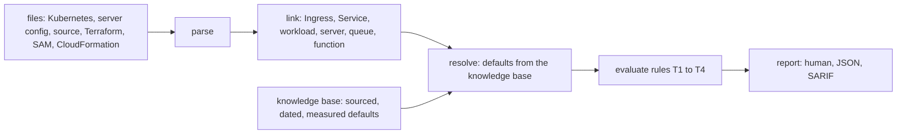

Text fallback: tripcurve is a pipeline of five stages, each a function over a typed model: parse the files, link the objects that belong together, resolve every value (from a file, a declaration or a knowledge-base default), evaluate rules T1 to T4, and report in human, JSON or SARIF form. The knowledge base feeds the resolve stage. The folders `src/parse`, `src/link`, `src/resolve`, `src/evaluate` and `src/report` hold the stages, and `src/kb` holds the knowledge base.

It never runs your code and never touches the network. See [docs/security.md](docs/security.md).

## Why it should exist

Electrical engineers run a time-current coordination study so that breakers trip in the right order. Software timeouts need the same ordering, and today's defaults often have it backwards. Every fact below is from `docs/research.md` (sources and dates there) unless it names another file.

- Node.js core raised its `keepAliveTimeout` default from 5 s to 65 s (PR #62782, merged 2026-04-26). The stated reason is from the superseded PR #59203: "The previous default of 5 seconds is shorter than the defaults used by common infrastructure". Every released Node line keeps 5 s until v27. (`docs/research.md` section 7 and section 2)
- Measured defaults: Node 22.23.2 closes an idle connection at 6.0 s, gunicorn 26.2.0 with the uvicorn worker at 2.0 s, uvicorn 0.54.0 at 5.0 s. An AWS ALB keeps idle connections for 60 s by default. (`docs/research.md` section 2; re-measured 2026-11-11 in section 13)
- nodejs/node #27363 is the ALB 502 caused by this mismatch. aws-load-balancer-controller #2366 (95 thumbs-up, 77 comments, closed not planned) has 31 comments about the preStop and grace settings that T2 and T3 check; the research counts it as demand for the configuration check only. (`docs/research.md` section 7)
- Honest limit: no issue asks for a linter by name. Demand is inferred from symptoms and from Node changing its own default. (`docs/research.md` section 12)

### The 6-of-26 result, and its limit

In a local reproduction, 6 of 26 requests in an idle-gap sweep failed against Node 22.23 with default settings, all in the 20 ms before the server's idle close. With `keepAliveTimeout = 65000` the same sweep failed 0 of 26 requests. gunicorn 26.2.0 with the uvicorn worker also failed 6 of 26 at its defaults, and 0 of 26 with `--keep-alive 75`. (`docs/research.md` section 2)

This result always comes with its limit:

> The race reproduction is Node 22.23 and gunicorn+uvicorn on one laptop through toxiproxy, not an ALB. The ALB's real behaviour at the idle boundary is not measured.
>
> Source: the research notes, sweep 2026-10-29, re-checks through 2026-11-02, reproduction dated 2026-11-02 (`docs/research.md` section 12, item 2)

It shows the mechanism, not an ALB measurement. An earlier attempt found 0 failures in 70; the report calls it a flawed experiment (it swept the wrong gaps and used Node's own HTTP agent), and its corrected run is the one above. (`docs/research.md` section 2)

## How it differs from what exists

- Kubernetes linters (kube-score, kube-linter, Polaris, Popeye, Kubescape, Datree) check single objects. (`docs/research.md` section 5)
- RPC timeout tools (retrystack, Stormcheck, resilience-config-lint, plimsoll) model service-to-service retries; none has a rule for load balancer idle vs keep-alive, pod termination or queue visibility (searches run 2026-10-29 to 2026-11-02; awesome-* lists and PyPI were not swept). (`docs/research.md` section 5)
- Only the SQS and Lambda rule (T4) exists elsewhere: cdk-nag (CDK only) and cfn-lint E3505. tripcurve credits it and ports it to Terraform, SAM and CloudFormation. The new part is T1 to T3. (`docs/research.md` section 5; `tripcurve --explain T4`)

## Size

Medium. The research estimated 5-7 days of coding for the MVP, one person with Claude Code, part-time, for the open-source core only; review rounds were extra and no deadline applied. (`docs/research.md` section 8)

## Install from a checkout

tripcurve is not published to npm, so there is no `npm install tripcurve`. Node 22.12.0 or later is required (`package.json`, `engines`). From a checkout:

```sh
npm ci --ignore-scripts
npm run build
cd path/to/the/repository/you/want/to/check
node path/to/tripcurve/dist/cli/main.js .
```

All commands run from the checkout's `node_modules`; tripcurve has three runtime dependencies (`commander`, `ts-morph`, `yaml`), listed in `package.json`.

## The three-step demo

[demo/README.md](demo/README.md) walks through a made-up shop in under five minutes, with no containers, cluster or cloud account:

1. First run: 14 files read, 4 failed, 1 unresolved, 1 not evaluated, 1 not applicable and 3 passed; exit 1. (`demo/expected/first-run.txt`)
2. Apply the three fixes in `demo-fixed/`: the four failures go away, the run still exits 1 because T3 cannot be decided yet.
3. Declare the longest request in `tripcurve.yaml`: `All checks passed (9), 1 not applicable.` and exit 0. (`demo/expected/after-fix.txt`)

An end-to-end test compares both outputs byte for byte (`test/e2e/demo.e2e.test.ts`).

## Result kinds

Every result carries one of these words. Only PASS and N/A leave a run clean. (`docs/rules.md`)

| Word | Meaning | Makes the run unclean |
|---|---|---|
| PASS | the rule holds, every value established | no |
| FAIL | the rule is broken, every value established | yes |
| WARN | T3 only: the worst case, from the server's ceiling, is not covered | yes |
| UNRESOLVED | a value could not be established; the line says what to declare | yes |
| VERSION-DEPENDENT | T1 only: the version is not exact and the possible versions differ; never PASS | yes |
| NOT EVALUATED | T3 only: T2 failed for the workload | yes |
| N/A | the rule does not apply (T1 on the gunicorn sync worker) | no |
| WAIVED | a valid, unexpired waiver covers a finding; printed with its date and reason | no |

Files that could not be read, and waivers that are invalid or match nothing, also make a run unclean.

What a run reads, and what it does when a file is not readable (`docs/limits.md` has every bound):

- A file over 5,000,000 bytes is listed as `over-size`, and a Node or TypeScript source with more than 500,000 syntax nodes is listed as `source-too-large`; each is listed under "Files not checked", nothing is read from it, and what depended on it is UNRESOLVED.
- A syntax error in a linked Node or TypeScript source is listed as `source-parse-error`, with the line of the first error; T1 then says the source could not be parsed.
- Kubernetes manifests are read as block YAML, YAML with quoted keys, YAML flow mappings and JSON, and a `kind: List` or a list of objects at the root of a file is unwrapped. A manifest in any of these forms gives the same findings as its block-style twin.

## Exit codes

| Code | Meaning |
|---|---|
| 0 | clean, or "No failures:" (every finding waived), or only not-applicable results |
| 1 | not clean |
| 2 | nothing checked, or a usage or configuration error |
| 3 | internal error; nothing was verified |

(The maintainer decided these exit codes on 2026-11-10; the help text is below.) There is no `--fail-on` flag: a threshold flag would invite turning UNRESOLVED green after the fact.

## Command-line reference

The text below is the output of `node dist/cli/main.js --help` (a test compares it to the built command).

```text
Usage: tripcurve [options] [path]

Checks that timeouts between infrastructure layers are ordered correctly.
Reads files only; never runs your code, makes network calls or sends data.

Arguments:
  path               directory to check, or - for rendered YAML on stdin
                     (default: .)

Options:
  --explain <rule>   explain T1, T2, T3 or T4, then exit
  --format <format>  human, json or sarif (default: human)
  --config <file>    tripcurve.yaml to use (default: tripcurve.yaml at path)
  --verbose          show the full chain under every result
  --no-color         never use colour (NO_COLOR is also honoured)
  --version          print the version
  --help             print this help

Exit codes: 0 clean or "No failures:", 1 not clean, 2 nothing checked or
usage or config error, 3 internal error.
```

`tripcurve --explain T1` prints a rule, its vendor quote with the date it was read, and every knowledge-base default the rule uses with its basis. Declarations that settle what the files cannot show (`longest_request_s`, `drain.in_process_s`, `runtime.node`, `source`, `load_balancer`) and waivers go in `tripcurve.yaml`; see [docs/rules.md](docs/rules.md) and [docs/security.md](docs/security.md).

## Green does not mean zero-downtime

A clean run means the rules tripcurve checks hold for the files it read. It does not prove a rollout is safe: the SIGTERM race and the load balancer's deregistration delay are outside the rules, and whether the code really drains on SIGTERM is a runtime question. Every report says so under Assumptions: "Green never means zero-downtime: the SIGTERM race and the deregistration delay are outside these rules." (`demo/expected/first-run.txt`; `docs/research.md` section 4)

## Test evidence

Everything below was run on the maintainer's machine (Mac17,3, Apple M5, macOS) on a fresh checkout of this repository on 2026-11-15, except where a row names an earlier date, after two independent black-box testing passes whose findings were fixed first (`docs/evidence/black-box-testing.md`). Each screenshot shows the command's real output, excerpted only where the image says so; the full transcripts are in `docs/evidence/`. The two hosted rows were run by GitHub on its own runners on the first push, 2026-11-15, not on that machine.

| Check | What it covers | Result |
|---|---|---|
| `npm run verify` | typecheck (tests included), Biome, 13,115 tests in 141 files with 96.74% line coverage, the measurement self-test, the build, the timed check, as recorded at B23 (`docs/evidence/verify-summary.txt`); B24 and B25 added tests, so a checkout today runs 13,127 tests in 142 files | pass |
| Demo, first run | the three-step demo before the fix: 4 failed, 1 unresolved, exit 1 (`docs/evidence/demo-first.txt`); run from inside `demo/` it is byte-equal to `demo/expected/first-run.txt` (`docs/evidence/node-matrix.txt`) | pass |
| Demo, after the fix | nine PASS and one not-applicable, exit 0 (`docs/evidence/demo-fixed.txt`); run from inside `demo-fixed/` it is byte-equal to `demo/expected/after-fix.txt` (`docs/evidence/node-matrix.txt`) | pass |
| Four real repositories | trimmed copies of public MIT repositories under `test/fixtures/real/`, each judged by hand against the real files: one real T2 failure, one real T4 failure, one T4 pass, the rest honest UNRESOLVED (`docs/evidence/real-*.txt`) | pass |
| Formats | human, JSON and SARIF agree on exit code and counts; the SARIF of every golden and live run validates against the official SARIF 2.1.0 schema, with three broken copies rejected (`docs/evidence/sarif-schema.txt`) | pass |
| Hostile input and fuzzing | 91 hostile cases and 600 random mutations: no crash, no hang, no stack trace, ASCII output, no input text in the tool's own voice (`docs/evidence/black-box-testing.md`) | pass |
| Node releases | the full suite and the demo on Node 22.12.0 (the oldest supported), 24.22.3 and 26.13.1; Node 20 and 18 refused with the fixed message, exit 2 (`docs/evidence/node-matrix.txt`) | pass |
| Measurement lanes | the pinned lane of 2026-11-12: 110 of 110 measurable cases within tolerance on a quiet host; 36 entries measured, 9 not measurable locally (AWS and Kubernetes defaults, documented), 3 deferred (old Node lines, labelled unmeasured) (`measure/results/2026-11-12-lanes-pinned-b15.txt`); the case list as of 2026-11-15 is in `docs/evidence/lanes-list.txt` (a listing; nothing started) | pass |
| Supply chain | `npm audit`: 0 vulnerabilities for the checkout; every dependency pinned with an integrity hash in `npm-shrinkwrap.json`; a consumer of the packed tarball would not be clean, which is why the package stays private (`docs/evidence/audit.txt`, `docs/security.md`) | pass, with the stated caveat |
| Hosted verify | `npm run verify` on GitHub's runners after the first push (commit `cf55f77`): Ubuntu with Node 22.12.0, 24 and 26 and macOS with Node 22.12.0, all four jobs succeeded in run 43682221175; this was the first run of the suite on Linux, where the Node 22.12.0 job reports 142 test files, 13,111 tests passed and 14 skipped, and the timed check skipped because it is not the recorded machine (`docs/evidence/gh-hosted-runs.txt`, `docs/evidence/gh-linux-verify.txt`) | pass |
| Hosted Action self-test and SARIF upload | run 43682221183: the jobs `clean`, `failing` and `upload` all succeeded; the `upload` job sent the demo's SARIF to GitHub code scanning, which created an analysis at 2026-11-15T05:42:42Z (tool tripcurve 0.1.0, 6 results, 7 rules) and six open alerts at the demo's files and lines (`docs/evidence/gh-hosted-runs.txt`, `docs/evidence/gh-code-scanning.txt`) | pass |
| GitHub Action | dry runs of the composite steps on `demo-fixed` (exit 0, SARIF written) and `demo` (exit 1, SARIF still written); the upload step is off by default (`docs/evidence/action-dry-fixed.txt`, `docs/evidence/action-dry-demo.txt`) | pass |
| Docs | every command in the docs run as written and compared with its claimed output (`docs/evidence/black-box-testing.md`) | pass |

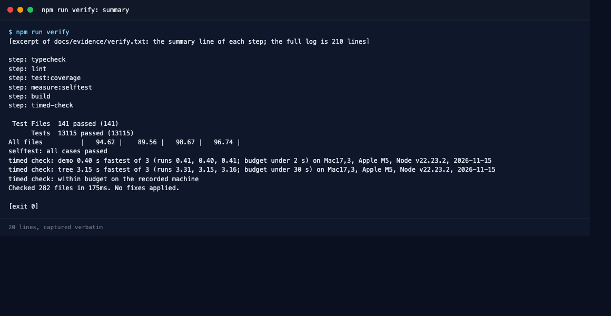

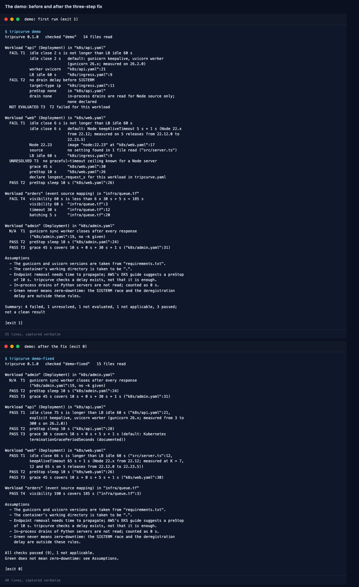

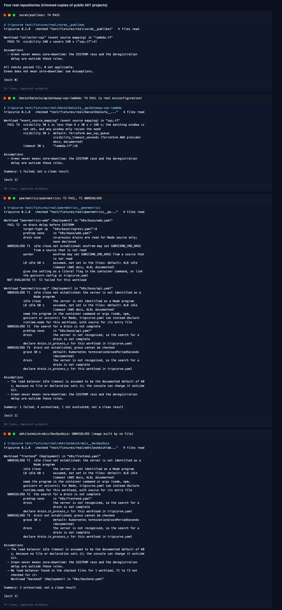

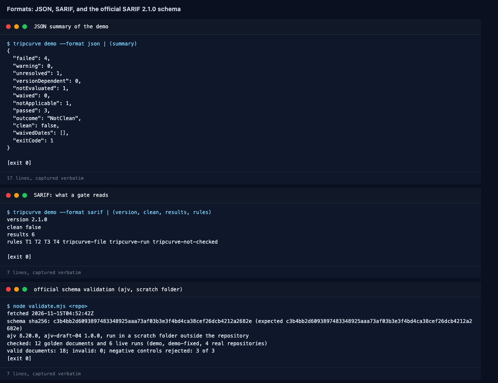

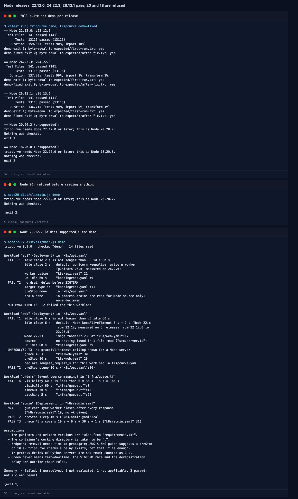

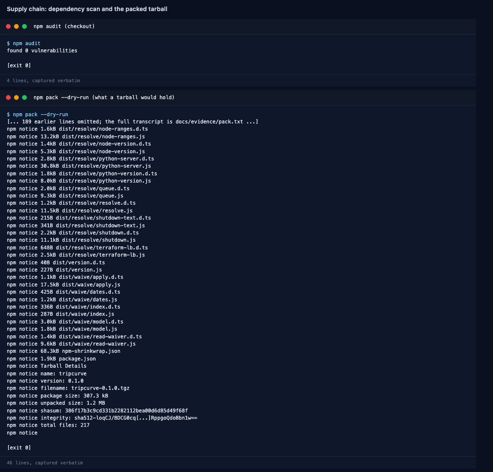

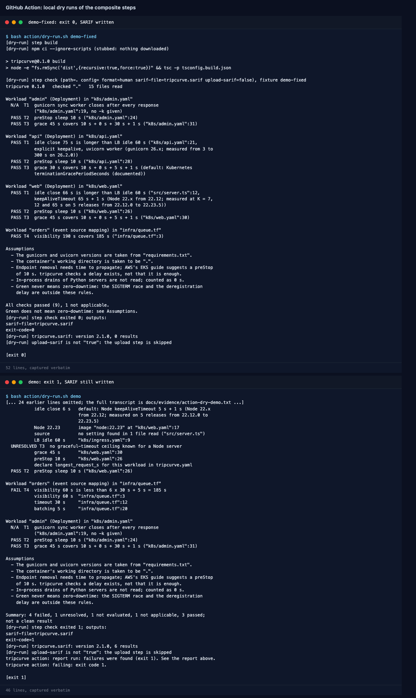

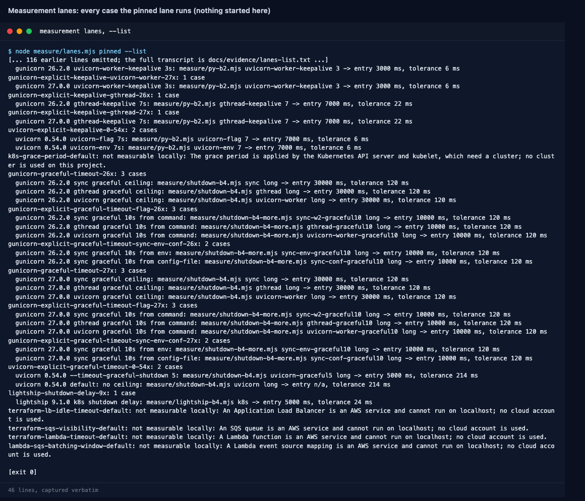

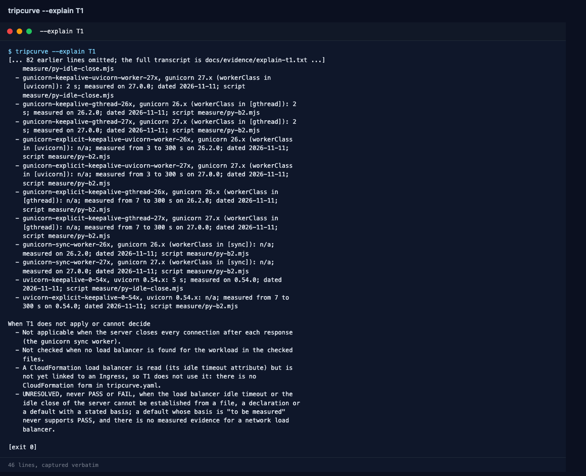

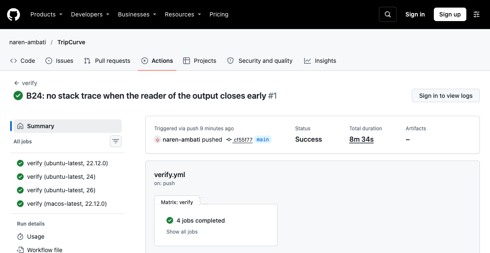

*The verify run on GitHub (run 43682221175): four jobs, Linux and macOS.*

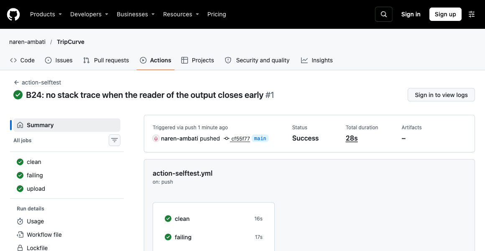

*The Action self-test run on GitHub (run 43682221183): clean, failing and upload.*

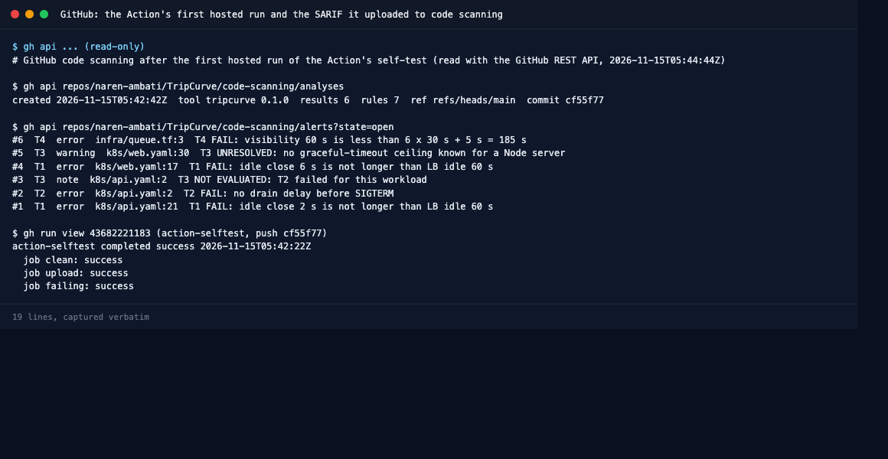

*The analysis and the six open alerts that the upload created, as read from the GitHub REST API.*

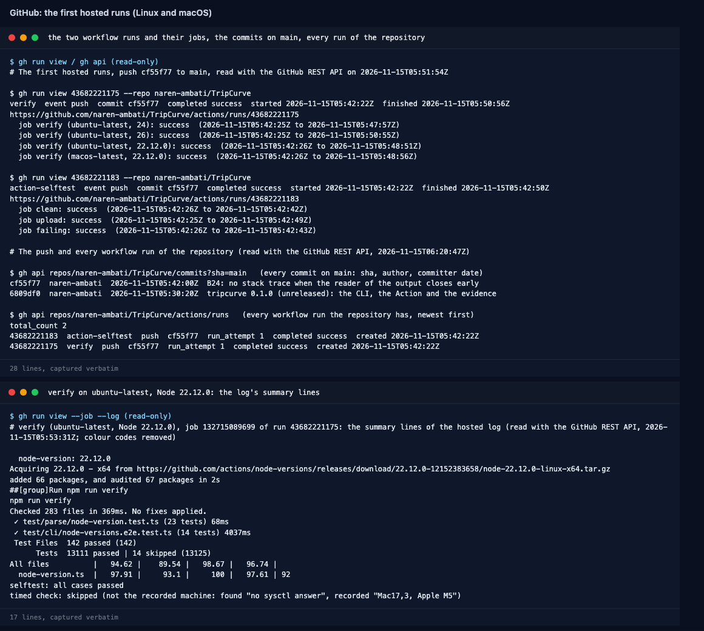

*The two runs and their jobs, as read from the GitHub REST API.*

## Documentation

| Page | What is in it |
|---|---|
| [docs/rules.md](docs/rules.md) | T1 to T4: the inequality, the vendor quote, what each result kind means |
| [docs/how-defaults-were-measured.md](docs/how-defaults-were-measured.md) | how the knowledge-base defaults were measured, and the limits of that |
| [docs/add-a-knowledge-base-entry.md](docs/add-a-knowledge-base-entry.md) | step by step: add an entry with its measurement script |
| [docs/ci-and-sarif.md](docs/ci-and-sarif.md) | the GitHub Action and SARIF; how a gate should read a run |
| [docs/action.md](docs/action.md) | the Action's inputs, outputs and exit behaviour |
| [docs/security.md](docs/security.md) | what tripcurve does and never does with your files; waivers |
| [docs/limits.md](docs/limits.md) | every limit on what is read, with its basis |
| [docs/release-checklist.md](docs/release-checklist.md) | the release checks, what ran locally, and the open questions for the maintainer |
| [docs/research.md](docs/research.md) | everything known, with sources and dates |
| [docs/arena-report-extract.md](docs/arena-report-extract.md) | verbatim source sections |
| [BUILD-NOTES.md](BUILD-NOTES.md) | the record of every bolt and review |

`docs/research.md` is the research notes that the tool cites, and `docs/arena-report-extract.md` is the verbatim extract of the maintainer's project-selection report that the numbers trace to.

Licence: decided by the maintainer before release.
