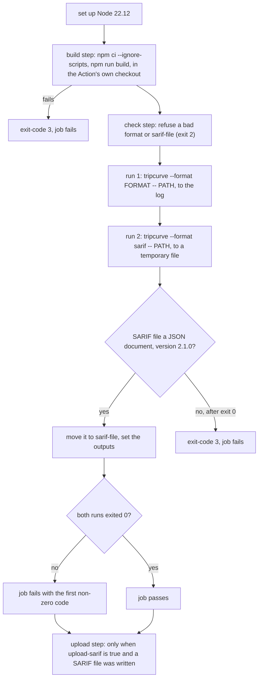

# The tripcurve GitHub Action

Status: **written, checked locally, and run on GitHub.** Its self-test ran on both pushes of 2026-11-15, runs 43682221183 and 43686256564, and all three jobs succeeded each time (B25, B27; the verify workflow ran in runs 43682221175 and 43686256521, the second failing its macOS job in a test unrelated to the Action; the fix is made in B27 and not yet re-run on GitHub); publishing the Action for others waits for the maintainer's go. Licence: decided by the maintainer before release.

The Action is a composite Action defined in `action.yml`; all its shell logic is in `action/run.sh`, which is tested without GitHub (`test/action/`).

## Usage

```yaml
# .github/workflows/tripcurve.yml in the repository being checked
name: tripcurve
on: [pull_request]

permissions:
  contents: read
  # security-events: write   # only when you set upload-sarif: "true" (see below)

jobs:
  check:
    runs-on: ubuntu-latest
    steps:
      - uses: actions/checkout@<full commit SHA>   # pin by commit, comment the tag
      - uses: <owner>/tripcurve@<full commit SHA>  # name and ref are set at release; not published yet
        with:
          path: .
          format: human
          sarif-file: tripcurve.sarif
          # upload-sarif: "true"   # opt-in; see "The SARIF upload is opt-in"
```

## Inputs

| Input | Default | Meaning |
| --- | --- | --- |
| `path` | `.` | Directory to check; `-` reads rendered YAML from standard input (which is empty in a workflow). Passed to the CLI after `--`, so a path that starts with `-` is a path, never a flag. |
| `config` | none | Path of a `tripcurve.yaml`. Passed as the value of `--config`. |
| `format` | `human` | Format of the report in the job log: `human`, `json` or `sarif`. Anything else is a usage failure (exit 2): the message quotes the bad value as data. |
| `upload-sarif` | `false` | The string `true` (compared without regard to case, as GitHub's `==` does) uploads the SARIF file to GitHub code scanning after the check, including after a failed check. Any other value, or no SARIF file written, skips the upload. See "The SARIF upload is opt-in". |
| `sarif-file` | `tripcurve.sarif` | Where the SARIF file is written, relative to the workspace. A path that is absolute, has a `..` part or a control character, names a directory or an existing symlink, or goes out of the workspace through a symlink is refused (exit 2). Missing folders are created inside the workspace. |

## Outputs

| Output | Meaning |
| --- | --- |
| `sarif-file` | The path given in `sarif-file`, set only when the file was written and checked (a JSON document with `version` `2.1.0` and a `runs` list). |
| `exit-code` | Always set, as an integer string. The CLI's own code when it ran (0, 1, 2 or 3), or: 127 when `node` or the CLI file is missing, 128 plus the signal number when the CLI was killed (SIGKILL is 137), 3 when the build failed or when both runs exited 0 but the SARIF file could not be trusted. When both runs fail, the first non-zero code (the report run's) is used. |

## What the Action does



Text fallback: set up Node; build the CLI from the Action's own checkout (tripcurve itself is never fetched from a registry at run time; its pinned dependencies are, by `npm ci --ignore-scripts`, checked against the shrinkwrap's integrity hashes); run the CLI for the log; run it again with `--format sarif` into a temporary file; check the file; move it into place; set the outputs; fail on any non-zero code; the upload step runs only when `upload-sarif` is `true` and a SARIF file was written, and it also runs after a failed check.

## Exit behaviour

The job passes only when both CLI runs exit 0 and the SARIF file is valid. Otherwise it fails, and the log says why in the Action's own fixed words:

| Cause | Job | Log says |
| --- | --- | --- |
| exit 1 | fails, `exit-code` 1 | failures were found |
| exit 2 | fails, `exit-code` 2 | nothing was checked, or the command line or configuration was refused |
| exit 3 | fails, `exit-code` 3 | an internal error; nothing was verified; not a list of failures |
| killed by a signal | fails, `exit-code` 128 + signal | stopped by signal N; nothing was verified |
| `node` or the CLI missing | fails, `exit-code` 127 | nothing was checked |
| build failed | fails, `exit-code` 3 | build failed; nothing was checked |
| exit 0 but empty or invalid SARIF | fails, `exit-code` 3 | the SARIF output is empty or is not a SARIF 2.1.0 document |
| bad `format` or `sarif-file` | fails, `exit-code` 2 | the rule, and the bad value quoted as data (printable ASCII, at most 80 characters) |

The SARIF file is still written when the report run exits 1, so findings can be uploaded after a failure.

## Security notes

- No input is ever written into a script body. `action.yml` passes the four inputs as environment variables (`TRIPCURVE_PATH`, `TRIPCURVE_CONFIG`, `TRIPCURVE_FORMAT`, `TRIPCURVE_SARIF_FILE`) and the script quotes them. A test fails if a `run:` body contains `${{`.
- The Action requests no token and prints no secret. `permissions: contents: read` is enough, unless `upload-sarif` is `true` (see below).
- Third-party Actions are pinned to full commit SHAs, looked up read-only on 2026-11-12 (`docs/lookups-b9.txt`). `actions/setup-node` v7.1.0 and `github/codeql-action/upload-sarif` v4.39.3.
- Hosted-runner details beyond what the self-test asserts are unverified.

## The SARIF upload is opt-in

`action.yml` contains the standard code-scanning upload (`github/codeql-action/upload-sarif`, pinned to a full commit SHA). It is off by default: it runs only when the input `upload-sarif` is the string `true` (any case) and the check step wrote a SARIF file. Its condition starts with `always()`: a step with no status check function gets the default `success()` and would be skipped after the check step failed, which is exactly when the findings matter (GitHub's expressions documentation, read 2026-11-13; `docs/lookups-b19.txt`). `upload-sarif` is used only in that condition and never in a script body.

To enable it, the calling workflow needs:

1. `permissions: security-events: write` (and `contents: read`) for that job. The Action passes no token and no secret; the upload action defaults to the job's own `GITHUB_TOKEN` (its `action.yml`, read 2026-11-13).
2. A public repository, or a private one with GitHub code security. Without that, GitHub is expected to reject the upload, and the upload step would fail (not verified).
3. A workflow that is not a pull request from a fork: a fork's token is read-only (not re-read today), so the upload is expected to fail there.
4. `with: upload-sarif: "true"`.

Paths in the SARIF are relative to the directory that was checked (`SRCROOT`), so with a `path` other than `.` they do not match files in the repository; see `docs/ci-and-sarif.md`.

The upload is an external write to a repository's code-scanning data. It ran on both pushes of 2026-11-15 in the `upload` job of `.github/workflows/action-selftest.yml` (runs 43682221183 and 43686256564, both successful); after the first, GitHub created an analysis at 2026-11-15T05:42:42Z (tool tripcurve 0.1.0, 6 results, 7 rules) and six alerts are open (`docs/evidence/gh-code-scanning.txt`). Tests check the condition, the default and that it is the only conditional step.

## The self-test workflow

`.github/workflows/action-selftest.yml` (prepared in B19; first run on 2026-11-15, run 43682221183, all three jobs succeeded) runs the repository's own Action with `uses: ./` in three jobs:

| Job | Runs on | Asserts |
| --- | --- | --- |
| `clean` | `demo-fixed` | `exit-code` is `0`; the SARIF file exists and is a JSON document with `version` `2.1.0` |
| `failing` | `demo`, with `continue-on-error: true` | the step's `outcome` is `failure`; `exit-code` is `1`; the SARIF file exists and is version `2.1.0` |
| `upload` | `demo`, with `upload-sarif: "true"` and `continue-on-error: true` | the same as `failing`; the job has `security-events: write` and runs only for a public repository (`github.event.repository.visibility == 'public'`) and for a push or a same-repository pull request |

The assertions read the outputs through `env:`, never through `${{ }}` inside a `run:` body. Because the Action step has `continue-on-error`, the `upload` job cannot tell a failed upload from the expected failed check: it shows that the SARIF file was written and the step failed with exit code 1, and the result of the upload is read from the log of the upload step and from the repository's code-scanning page.

## Local dry run

`action/dry-run.sh [fixture]` runs the Action's two steps against a copy of a fixture repository in a temporary workspace, with `actions/setup-node` skipped and `npm ci` stubbed so nothing touches the network. Example: `action/dry-run.sh demo` exits 1, as the Action would. It simulates the three self-test jobs (`demo-fixed`, `demo`, and `demo` with `DRY_RUN_UPLOAD_SARIF=true`; `DRY_RUN_SARIF_FILE` sets the `sarif-file` input; `DRY_RUN_ACTION_PATH` names the Action checkout to build and run, by default this repository, and the tests pass a scratch copy so the build step does not empty this `dist/`), checking the exit code, the outputs and the SARIF file. It never runs the upload: it only evaluates the step's condition and prints whether the step would run, marked NOT SIMULATED, because uploading is an external write.

## Not tested

What the first hosted run (2026-11-15, run 43682221183) did not check: a pull request, a fork and a private repository were not tried, because the run was a push to a public repository. The result of the upload was read from the repository's code-scanning page (the analysis and six alerts), not from the job, which cannot tell a failed upload from the expected failed check. No job fails the build step, so whether `steps.build.outputs.exit-code` is readable after a failed build is still untested. Runner details beyond the self-test's assertions are unverified.
