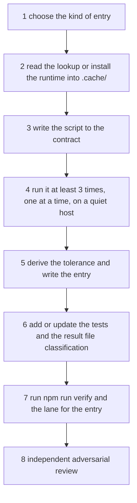

# Add a knowledge-base entry

This page is written so that a contributor, or a fresh AI coding session with only these docs and the repository, can add one knowledge-base entry together with its measurement script, and the maintainer can review the result. It is the path tested by the release-quality dry run (metric 5, `docs/release-checklist.md`). The only network use is read-only (GET lookups and downloads into the git-ignored `.cache/`).

Read first: [how-defaults-were-measured.md](how-defaults-were-measured.md) (the method and its limits) and [rules.md](rules.md) (what the rules do with a default).



Text fallback: choose the kind of entry; get the evidence (a dated lookup, or the runtime installed into `.cache/`); write the measurement script to the contract; run it at least three times, one at a time, on a quiet host; derive the tolerance and write the entry; add or update the tests and classify the result file; run `npm run verify` and the lane for the entry; and have an independent adversarial review read it before it is merged.

## 0. Before you start

- Work on a branch of your fork or clone (`git switch -c <branch>`, or a worktree: `git worktree add .worktrees/<name> -b <branch>`), never on `main`, and open a pull request when the entry is done. Do not publish to npm: the package is private until the maintainer decides a licence. No special commit identity is needed.
- Node 22.12.0 or later, then `npm ci --ignore-scripts` in the worktree. Run every tool from the worktree's `node_modules` (`npm run ...`, `./node_modules/.bin/...`), never a bare `npx`: a bare `npx` can fetch and run an unrelated registry package. (`BUILD-NOTES.md`, B8 "Process slip")
- The measurement lanes look for installed runtimes in `.cache/` of the worktree, or of the main checkout when you are in a worktree. Node tarballs live in `.cache/node/node-v<version>-darwin-arm64/`; Python environments in `.cache/py-g26`, `.cache/py-g27` and `.cache/py-latest-*`; lightship in `.cache/lightship`. (`measure/lib/lanes-runner.mjs`)
- A timing measurement must not share the CPU: check `uptime` first, and run on a quiet machine (the 1-minute load average below half the number of cores). (`measure/README-lanes.md`)
- **Which Node lines get an entry.** Even-numbered release lines only: 18, 20, 22, 24 and 26 today. Odd-numbered lines (19, 21, 23, 25, 27 and later) have no entry by design and are UNRESOLVED ("no knowledge-base entry covers <version>"), never the nearest range. `docs/limits.md`, "Node version ranges and the explicit idle close (B3, 2026-11-11)", first bullet, says so, and `test/kb/knowledge-base.test.ts` ("gives no entry ... below each measured lower bound") asserts that 25.1.0 has none. Adding an odd line is a product decision for the maintainer, not a data task. To add the next even line, list the releases with a read-only GET of `https://nodejs.org/dist/index.json` (a JSON array; each item has `version`, `date` and `lts`), pick the lowest and newest plain releases of the line, and note the date you read it.
- **Build and environment.** `npm run verify` builds the command twice: into `dist/` (the build step) and, for the golden and end-to-end tests, into `.cache/e2e-build` (git-ignored; `test/support/global-setup.ts` removes and rebuilds it at every test run and never touches `dist/`). The tests call `node_modules/.bin/tsc` from the repository root, so `node_modules` must resolve from the root of the worktree you run in: run `npm ci --ignore-scripts` there, or link the main checkout's `node_modules`. A scratch copy of the repository needs the same.

## 1. Choose the kind of entry

| You want to add | Kind | What it needs |
|---|---|---|
| a default of a runnable server for a new version or release line (a new Node line, a new gunicorn major, a new uvicorn minor) | measured | a script run, `basis: "measured"`, a tolerance |
| a default that a vendor documents for a service that cannot run on localhost (an ALB, a queue, a function, a cluster) | documented | `basis: "documented"`, a stated reason instead of a script, a dated lookup |
| a behaviour of a setting nobody models yet (a new `subject`) | new subject | code: the schema list, the lane planner, the resolver and rule that use it; not only data |

(`src/kb/schema.ts`; `measure/lib/lanes-core.mjs`.) A **new subject is a code change**, not a data change: add it to `KB_SUBJECTS` in `src/kb/schema.ts`, add a `case` to `planCases` in `measure/lib/lanes-core.mjs`, make the resolver in `src/resolve/` use it, and list it in the `subjects` of the rule in `src/evaluate/explain-entries.ts`. Treat it as a design change and follow the project's bolt process. The rest of this page covers the two data cases.

A "stated reason" is allowed only for a `documented` entry whose subject is on the closed list in `src/kb/schema.ts` (`REASON_FORM_SUBJECTS`) and whose runtime is `alb`, `kubernetes`, `terraform` or `cloudformation`. It is never allowed for a runtime the scripts can start (node, gunicorn, uvicorn, lightship); the lane treats that as a gap. Deferral (`deferredTo`) is allowed only for the old-Node `headersTimeout` trap entries. (`measure/lib/lanes-core.mjs`)

## 2. The entry schema

An entry is data, not code. The loader (`src/kb/schema.ts`, `loadKbEntries`) rejects an entry that is missing a required field or has a malformed one, and names the entry id; unknown fields are rejected too. A knowledge-base file is `{ "schemaVersion": 1, "entries": [ ... ] }`.

| Field | Required | Rule |
|---|---|---|
| `id` | yes | unique, kebab-case, for example `node-idle-close-26x` |
| `subject` | yes | one of `KB_SUBJECTS` in `src/kb/schema.ts` |
| `value` | yes | a number of 0 or more, or `"n/a"`; for an explicit-setting entry it is the extra time added to the setting, for example the extra 1 s of `node-explicit-keepalive-22x` (`src/kb/data/node-idle-close.json`) |
| `unit` | yes | `s` or `ms` |
| `applies.runtime` | yes | a runtime name: the existing entries use `node`, `gunicorn`, `uvicorn`, `lightship`, `alb`, `kubernetes`, `terraform` and `cloudformation` |
| `applies.versionRange` | yes | `*`, or `>=X.Y.Z`, `<X.Y.Z`, or both separated by a space. A Node entry covers exactly one release line: never `*`, never a range across lines |
| `applies.condition` | no | only `workerClass in [a, b]` |
| `citationName` | yes | the words printed in the citation, for example `Node keepAliveTimeout 5 s + 1 s` (`src/kb/data/node-idle-close.json`) |
| `rangeLabel` | no | the range label in the citation, for example `Node 22.x from 22.12` |
| `docUrl`, `docDate` | yes | an `https` URL the value rests on, and the ISO date it was read |
| `basis` | yes | `measured`, `documented`, `from-source`, `from-changelogs` or `to-be-measured` (never supports PASS) |
| `measuredOn` | when `basis` is `measured` | `{version, date, platform}`; the date is the UTC date in the result records |
| `measuredVersions` | recommended for measured | the exact releases that were run; the printed basis counts and bounds them, and a test checks each against the result files |
| `measuredSpan`, `measuredKs` | explicit-setting entries (subject ending `-explicit`) | the smallest and largest explicit value, in seconds, that was run, and the values themselves |
| `scriptRef` | yes | a `measure/*.mjs` path, or `{"notMeasurableLocally": "<reason>"}`, or (closed list) `deferredTo` instead |
| `toleranceMs` | when `scriptRef` is a script | a positive number of milliseconds (see section 5) |
| `toleranceRelative` | only for an entry whose overshoot grows with the value (gunicorn's gthread explicit keepalive) | a fraction above 0 and below 1: the largest observed relative deviation; the tolerance at V s is `V * 1000 * toleranceRelative + 1` ms. Needs `toleranceMsAt` |
| `toleranceMsAt` | whenever `toleranceRelative` is set | `{"<value in seconds>": <ms>}` for every value that has observations of its own; it must hold the span minimum and the span maximum, so the relative rule never hides a 1 s error at the largest value (`docs/limits.md`, "The measurement lanes"). Only values inside `measuredSpan` |
| `measuredOptions` | only for `node-keepalive-explicit`, when the `createServer` options form was run | a list of `{k, versions}`, each version one of `measuredVersions`; the printed basis lists these runs. Omit it where the options form was not run |
| `sources` | required for `gunicorn-graceful-timeout-explicit`, and allowed nowhere else | the places the setting was measured from: `command`, `env`, `config-file`; a value from any other place is not covered |
| `notes` | no | text; existing entries cite the result lines and say what was not measured |

(`src/kb/schema.ts`.) A documented entry, in full:

Verbatim from `src/kb/data/alb.json`:

```json
{
  "schemaVersion": 1,
  "entries": [
    {
      "id": "alb-idle-timeout-default",
      "subject": "alb-idle-timeout",
      "value": 60,
      "unit": "s",
      "applies": { "runtime": "alb", "versionRange": "*" },
      "citationName": "ALB idle timeout",
      "rangeLabel": "AWS docs, ALB",
      "docUrl": "https://docs.aws.amazon.com/elasticloadbalancing/latest/application/application-load-balancers.html",
      "docDate": "2026-11-11",
      "basis": "documented",
      "scriptRef": {
        "notMeasurableLocally": "An Application Load Balancer is an AWS service and cannot run on localhost; no cloud account is used."
      },
      "notes": "AWS documents idle_timeout.timeout_seconds with the default of 60 seconds (read 2026-11-11). The value can be changed in the console outside Git, so its absence from the files does not establish it; a result that rests on it is unresolved."
    }
  ]
}
```

A measured entry looks the same, with `basis: "measured"`, a `measuredOn` object, a script path and a `toleranceMs`: copy the closest entry in `src/kb/data/node-idle-close.json` (Node), `python-servers.json` (gunicorn and uvicorn) or `shutdown.json` (graceful timeouts, lightship).

## 3. Where the data lives

- `src/kb/data/*.json`: `alb.json`, `cloudformation.json`, `node-idle-close.json`, `python-servers.json`, `shutdown.json`, `terraform.json`.
- `src/kb/default-knowledge-base.ts` imports each file with a static JSON import, and loads them together through `loadKnowledgeBase`. **A new data file must be imported there**; an entry added to an existing file needs nothing else. The JSON travels into `dist/` through the compiler (`resolveJsonModule`).
- The loader runs at load time, so a bad entry is a build-time fault, never input-reachable.

## 4. Write the script to the contract

A measurement script is standalone, about 15 lines, outside the shipped package (`measure/`, never `src/`), and starts the server under test on **127.0.0.1 only**. It prints exactly one JSON line to stdout:

```text
{entry, server, version, platform, date, resolution: {sweepStepMs, injectedLatencyMs}, measured: {idleCloseMs}}
```

Exit codes: 0 measured, 2 usage, 3 server not installed, 4 could not measure. Any other outcome prints no result line and exits 4. (`measure/README.md`)

Rules the existing scripts follow, which a new one must too (`measure/README.md`):

- measure with the shared client `measureIdleClose` from `measure/lib/idle-close.mjs`; do not write a second timer;
- a clean environment (only `PATH`, `HOME` and, for Python, `PYTHONDONTWRITEBYTECODE`), so the caller's shell cannot change the server's defaults; refuse to run (exit 4) when something that could change them, such as `NODE_OPTIONS`, is set;
- take the version from the running runtime, never from an argument;
- never print a number for an error: a reply that is not what was asked for, a reset, a server that never closes, or an interrupt is exit 4;
- stop the whole server process group on exit and on SIGINT or SIGTERM.

The smallest working example is the Node script.

Verbatim from `measure/node-idle-close.mjs`:

```js
// Default idle close of Node's http.createServer, measured with the Node
// that runs this script: `<node> measure/node-idle-close.mjs`. Prints one
// JSON line. Exit 0 measured, 4 could not measure.
import http from 'node:http';
import { measureIdleClose } from './lib/idle-close.mjs';

// NODE_OPTIONS could change the server under test, so a set value refuses.
if (process.env.NODE_OPTIONS) { console.error('could not measure: NODE_OPTIONS is set; run with a clean environment'); process.exit(4); }
const line = process.version.replace(/^v(\d+)\..*/, '$1');
const srv = http.createServer((req, res) => res.end('ok')); // all defaults
srv.listen(0, '127.0.0.1', async () => {
  const r = await measureIdleClose({ port: srv.address().port });
  srv.close();
  if (r.idleCloseMs === null) { console.error(`could not measure: ${r.error}`); process.exit(4); }
  console.log(JSON.stringify({
    entry: `node-idle-close-${line}x`, server: 'node http.createServer (defaults)', version: process.version.slice(1),
    platform: `${process.platform}-${process.arch}`, date: new Date().toISOString().slice(0, 10),
    resolution: { sweepStepMs: 1, injectedLatencyMs: 0 }, measured: { idleCloseMs: r.idleCloseMs },
  }));
});
```

For a Python server copy `measure/py-idle-close.mjs`; for a graceful-shutdown timer, `measure/shutdown-b4.mjs`; for lightship, `measure/lightship-b4.mjs`. The lane knows how to run each existing script (`planCases` in `measure/lib/lanes-core.mjs`) and which field of the line it reads: `idleCloseMs`, `sigtermToConnectionClosedMs` or `sigtermToHandlerStartMs`. A script of a **new shape** needs a `case` in `planCases` and a check in `compareLine`, with tests (`test/kb/lanes.test.ts`).

## 5. Measure, and derive the tolerance

**Busy host.** A run is busy when the 1-minute load average is above half the cores at its start, before a case, or at its end (the lane prints these samples; a busy run that passes prints `LANE PASS (host was busy: not an official run)` and exits 5). What to do when the host stays busy:

- **Wait, or run the measurement later.** Stop other work, check `uptime`, and measure when the load has fallen. Do not lower a threshold or widen a tolerance to get a pass.
- **A busy run is evidence only, never a basis.** It may show that a script works; it is never an observation that a tolerance rests on. Name its result file `measure/results/<date>-<tag>-busy.jsonl` or `measure/results/<date>-<tag>-loaded-<word>.jsonl` (`<word>` is lower-case letters only, for example `-loaded-parallel`). `test/kb/tolerance-evidence.test.ts` classifies a file with either name as evidence by its name (`-busy.jsonl` or `-loaded-[a-z]+.jsonl`), so it needs no list edit. Any other `*.jsonl` name must be put in the list `BASIS` (quiet, one at a time) or in `EVIDENCE_ONLY`, or the test "every result file is classified exactly once" fails.
- **The lane's `--raw` file** is named by you: `--raw=measure/results/<date>-<tag>-lane.jsonl` for a quiet run (a basis candidate: list it in `BASIS`, and keep the lane's printed output as `<date>-<tag>-lane.txt`, which the basis test reads for the host-load lines), and `--raw=measure/results/<date>-<tag>-busy.jsonl` when the host was busy.
- **The entry's tolerance while no quiet basis exists: the entry may not be added.** A tolerance is derived only from basis observations (item 4 below), and `derivedToleranceMs` refuses an empty set ("no observations"). `test/kb/tolerance-evidence.test.ts` fails a measured Node entry with no basis observation and says so. A `to-be-measured` placeholder is not a way round it: its basis never supports PASS, it is a release blocker, and the shipped-knowledge-base test (`test/kb/knowledge-base.test.ts`, "no seed is to-be-measured") refuses it. So keep the busy results as evidence, and add the entry after a quiet run exists. (The release-quality dry run of 2026-11-13 stopped at exactly this point: its tolerance stayed provisional because the host never got quiet; `docs/release-checklist.md`, row 10.)


1. **Install the runtime** into `.cache/`, from a source whose checksum you verify. For Node: download the tarball and `SHASUMS256.txt` from the same release folder on `nodejs.org/dist/v<version>/`, check the tarball's SHA-256 against its line in `SHASUMS256.txt`, and unpack it with `tar -xzf node-v<version>-darwin-arm64.tar.gz -C .cache/node`. For Python: a `uv` virtualenv with `uv pip compile --generate-hashes` then `uv pip install --require-hashes`. For lightship: `npm install --ignore-scripts` into `.cache/lightship-<version>`. These are the steps the latest lane performs for a newer release of an existing entry (`measure/lib/lanes-runner.mjs`).
2. **Run the script at least 3 times, one at a time**, for example `.cache/node/node-v<version>-darwin-arm64/bin/node measure/node-idle-close.mjs`, and keep every line in a new result file `measure/results/<date>-<tag>.jsonl`. Keep the raw output of any lookup in a dated text file beside it.
3. **Write down the dates as UTC.** The `date` in the records is the UTC date; see "Dates" in [how-defaults-were-measured.md](how-defaults-were-measured.md).
4. **Derive the tolerance by the rule**: the largest observed deviation from the value the entry predicts, plus the resolution of the script (the lane refuses a tolerance finer than the script's stated resolution). `derivedToleranceMs(deviationsMs, resolutionMs)` in `measure/lib/lanes-core.mjs` does the arithmetic. Only observations taken one at a time on a quiet host count as a basis. A tolerance is never widened after a failing run to make it pass: a failure is a finding to investigate. (`docs/limits.md`, "The measurement lanes")
5. **Say in `notes`** which result lines the value rests on, how the tolerance was derived, and what was **not** measured (the interior of the range, other values, other platforms), as the existing entries do.

## 6. Add or update the tests

These tests read the entries and the result files, so they tell you what to change. The values that used to be listed by hand are now computed from the data; what is left to touch for a new **Node** entry, with the file and the exact assertion, is this checklist. Tick every line.

- [ ] **`measure/results/`: the result file** is named by section 5 and classified, in `test/kb/tolerance-evidence.test.ts`: a quiet file is added to `BASIS`; a busy file is named `*-busy.jsonl` or `*-loaded-<word>.jsonl`. Assertion: "every result file is classified exactly once" (`BASIS.has(f) !== isEvidence(f)`).
- [ ] **`test/kb/tolerance-evidence.test.ts`, "covers every measured Node entry, each with basis observations, the shipped counts pinned":** nothing to edit for the check itself (it computes the Node entries from the data, and fails with "no basis observations" if the new entry has none). Optionally pin the new count by adding the entry id to `NODE_COUNTS`; the value is the number of basis runs inside the entry's range (the run count the test prints on failure).
- [ ] **`test/kb/tolerance-evidence.test.ts`, "each tolerance is the largest absolute deviation plus the 1 ms resolution":** nothing to edit; it fails when the stated `toleranceMs` is not `derivedToleranceMs(deviations, 1)` of the basis observations.
- [ ] **`test/kb/node-evidence.test.ts`:** add the result file to the list `FILES`. Assertions: each release in `measuredVersions` lies in the range, and each release (and each K) has at least 3 runs in the right case with the idle close the rule predicts.
- [ ] **`test/kb/knowledge-base.test.ts`, "the default idle close, one entry per release line ...":** add a tuple `[id, value s, range, measuredOn version]` to `expected`. Assertions: `value`, `unit`, `applies.versionRange`, `basis`, `measuredOn.version`, a `toleranceMs` of 4 or more and under 100, and the `notes` (see the next item).
- [ ] **the same test, the notes check:** `notes` must name a result file that exists (`measure/results/<file>.jsonl` or `.txt`, any date) and contain "not measured release by release". It no longer requires the date 2026-11-11.
- [ ] **`test/kb/knowledge-base.test.ts`, "gives no entry ... below each measured lower bound":** this list of versions with no entry contains the line's neighbours (for example `'25.1.0'`); for a new even line, remove versions that the new range now covers, and add the versions just below its lower bound. Assertion: `r.matches.length > 0` equals `covered`.
- [ ] **the same file, "the explicit-setting entries carry their measured span in seconds" and "the buffer property entries start where the property first appears":** add the new line to their loops or lists when the line has explicit-setting or buffer entries. Assertion: `measuredSpan` equals `{min, max}`.
- [ ] **`test/kb/knowledge-base.test.ts`, "loads, and is validated by the same loader" and "the Node entries do not overlap each other":** nothing to edit. The id list is computed from `src/kb/data/*.json` (it fails if a data file is not imported in `default-knowledge-base.ts`, or an id is duplicated or not kebab-case), and the overlap check runs over every `node-idle-close` entry.
- [ ] **`test/kb/lanes.test.ts`, "picks the newest plain release inside each range ...":** nothing to edit; the expected list is computed from the entries' ranges. Add the new line's release to the input list only if you want it exercised.
- [ ] **`how-defaults-were-measured.md`, the entry totals and the tolerance sentence:** update "Of the N entries in `src/kb/data/`", the `| basis | count |` rows, and "the N Node entries with a script have these tolerances: A ms (n entries) and B ms (k entries)". Assertions in `test/docs/docs.test.ts`: the totals equal the data files' counts by basis, and the tolerance sentence equals the computed set of tolerance values and their counts (any values, any number of them).
- [ ] **`docs/limits.md`, "Node version ranges ...":** add the line to the list of default idle closes and to the lines that have no entry; this page is not tested, so a reviewer must check it.
- [ ] **`test/golden/explain-t*.txt` and `test/golden/README.md`:** `tripcurve --explain` prints every entry of a rule's subjects, so a new entry changes a golden: review the diff line by line, then record the change in the golden README.

For other kinds of entry the same pattern holds: `test/kb/python-entries.test.ts` and `test/kb/shutdown-evidence.test.ts` (Python and shutdown evidence); `test/kb/terraform-evidence.test.ts` and `test/kb/cfn-evidence.test.ts` (a documented entry: add the dated lookup text to `docs/lookups-*.txt` and check the `docUrl` and quote against it); `test/kb/stated-reasons.test.ts` (the count of reason entries).

Add at least one **resolver-level** test that shows the new range in use (a version inside the range resolves to the entry; one just outside it is UNRESOLVED, never the nearest range). Every reproduced defect gets a test that fails before its fix. (`test/kb/knowledge-base.test.ts`, "lookup")

## 7. Run the checks

```sh
npm run verify
node measure/lanes.mjs pinned --only=<entry id> --raw=measure/results/<date>-<tag>-lane.jsonl
npm run build
```

`npm run verify` runs the typecheck (tests included), Biome, the unit, golden and end-to-end tests with the coverage floor, the measurement self-test, the build, and the timed check. `npm run verify:measure` runs the whole pinned lane, which takes many minutes; `--list` prints the plan without running anything. The `--raw` file is a new result file too: classify it in `test/kb/tolerance-evidence.test.ts` (section 6), and keep the lane's printed output beside it as a `.txt` file with the same name, because the basis test reads the host-load lines from that pair. A gap (an entry with no script or allowed reason, a script that does not exist, an entry no case can be planned for) stops the lane before anything runs, and the same check is a test. (`package.json`; `measure/README-lanes.md`)

## 8. The review

Every entry gets one independent, read-only adversarial review before it is merged, and a second pass when a fix changes what a check flags or what counts as pass. Hand the reviewer the diff and these questions:

- Does every claim in the printed basis correspond to a recorded run (a release, a value K, a platform)? Is anything claimed for a version or value that was not run?
- Does the range stop where the evidence stops? Is a version outside it UNRESOLVED?
- Is the tolerance exactly the rule's output over basis observations only? Could the lane fail at random, or pass a real 1 s error (`docs/limits.md`, "The measurement lanes")?
- Can anything in the entry support PASS while a value is unverified (`to-be-measured`, an assumed value)?
- Does the script run on 127.0.0.1 only, in a clean environment, and print no number for an error?
- Does any test exist that cannot fail? Show it failing by mutating the entry or the script.

(The failure classes to hunt: trusting fields that the input controls; anything chosen after the fact that changes the result; a 403, 404 or rate limit read as "gone" or as a failure; any surface saying pass or verified when something was unverified; input text shown in the tool's own voice; hostile input crashing or freezing the tool; credentials going where an input file says; tests that cannot fail.)

## 9. The release-quality dry run (metric 5)

The maintainer checks this page by having a fresh AI coding session, given only the repository and these docs, add one entry together with its script in a throwaway worktree, then reading the result against sections 4 to 8. If the session had to ask a question this page does not answer, the page is wrong.

The first dry run was done on 2026-11-13 and was a partial success: the entry, the tests, the lane and `npm run verify` all worked, and the tolerance stayed provisional because the host never got quiet. The friction it found (the odd-line policy, busy hosts, the incomplete and hard-coded test list, the build and environment notes) was fixed in B16 and is what sections 0, 5 and 6 now say. The maintainer may want to re-run the dry run against this fixed page. (`docs/release-checklist.md`, row 10)
