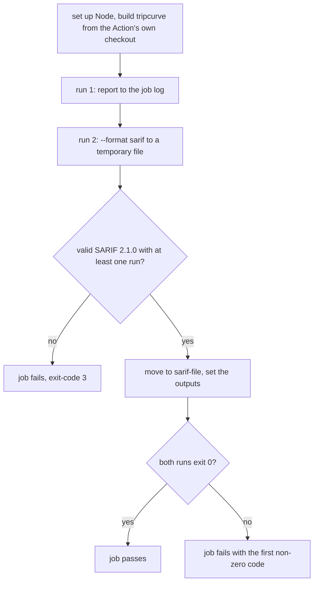

# CI and SARIF

How to run tripcurve in CI, and how to read its SARIF output so that a gate cannot be fooled. Dates are 2026.

## Status: written and checked as files only

- **The GitHub Action ran on GitHub once, on 2026-11-15.** `action.yml` and `action/run.sh` are tested without GitHub (`test/action/`), and a local dry run (`action/dry-run.sh`) exercises both steps. The self-test (`.github/workflows/action-selftest.yml`) ran on the first push in run 43682221183, and the jobs `clean`, `failing` and `upload` all succeeded; publishing the Action for others waits for the maintainer's go. (`docs/action.md`; `docs/evidence/gh-hosted-runs.txt`)
- **The hosted verify workflow** (`.github/workflows/verify.yml`) ran on the first push, on 2026-11-15, in run 43682221175: `npm run verify` succeeded on Ubuntu with Node 22.12.0, 24 and 26 and on macOS with Node 22.12.0, the first run of the suite on Linux. On Linux the timed check is skipped (no `sysctl`), and says so; the log of the Node 22.12.0 Linux job shows the skip. (`.github/workflows/verify.yml`; `docs/evidence/gh-linux-verify.txt`)
- **The SARIF upload is opt-in and has run once.** `action.yml` contains the standard code-scanning upload step. It is off by default and runs only when the input `upload-sarif` is `true` and a SARIF file was written; its condition uses `always()` so it also runs after a failed check. To enable it, set `upload-sarif: "true"` and give the job `permissions: security-events: write`; it needs a public repository or one with GitHub code security, and it is expected not to work for a pull request from a fork. Uploading is an external write to a repository's code-scanning data. On 2026-11-15 the `upload` job of the self-test enabled it, and GitHub created an analysis with 6 results and 7 rules (`docs/evidence/gh-code-scanning.txt`). (`docs/action.md`, "The SARIF upload is opt-in")
- The Action's name and ref are set at release; until then the usage example carries the placeholder `<owner>/tripcurve@<full commit SHA>`. (`docs/action.md`, "Usage")

## Using the Action

See [action.md](action.md) for the inputs (`path`, `config`, `format`, `sarif-file`), the outputs (`sarif-file`, `exit-code`), the exit behaviour and the security notes. In short:



Text fallback: the Action builds the CLI from its own checkout, runs it twice (once for the log, once with `--format sarif` into a temporary file), checks the file is a SARIF 2.1.0 document with a non-empty `runs` list, moves it to `sarif-file` and sets the outputs. The job passes only when both runs exit 0 and the SARIF file is valid; otherwise it fails, and the SARIF file is still written when the report run exits 1, so findings can be inspected after a failure. (`docs/action.md`)

## How a gate should read a run

**Do not gate on the presence of `error` results alone.** A run can be not clean while its only unsuppressed result is a `note`: with T1 and T2 waived, T3's NOT EVALUATED maps to `note` (the approved mapping), and a gate that read only `error` and `warning` would have passed. (`docs/limits.md`, "Review of B7: what changed in the SARIF document")

Two signals close that gap, and a gate should read one of them:

1. **`runs[0].properties.tripcurve.clean`**, which is `true` exactly when the run's exit code is 0 (outcomes Clean, NoFailures and NoChecksApply) and `false` otherwise. The same object carries `outcome`, the counts and `exitCode`. (`docs/limits.md`)
2. **The run-level warning.** Whenever `clean` is false and no unsuppressed `error` or `warning` exists, one `warning` result is added under the rule `tripcurve-run`, located at the checked root: "the run is not clean: N not evaluated; see the run properties". It is never added to a clean run, and never when another unsuppressed error or warning is already there. (`docs/limits.md`, "Review of B7")

A gate on `clean`, checked against the demo (`jq` 2026-11-12, `demo/` and `demo-fixed/` built from this checkout):

```sh
node dist/cli/main.js . --format sarif > tripcurve.sarif
jq -e '.runs[0].properties.tripcurve.clean == true' tripcurve.sarif
```

`jq -e` exits 1 for the first demo (`clean` is `false`) and 0 for `demo-fixed/` (`clean` is `true`); the run is recorded in `docs/release-check-run-b15.txt`. The Action's own `exit-code` output is the simplest gate of all, because it is the CLI's exit code (0 to 3; 127 when `node` or the CLI is missing; 128 plus the signal number when killed). (`docs/action.md`, "Outputs")

### What is in the SARIF document

| tripcurve result | SARIF |
|---|---|
| FAIL | `error` |
| WARN, UNRESOLVED, VERSION-DEPENDENT | `warning` |
| NOT EVALUATED | `note` |
| WAIVED | the level of the original kind, with a `suppressions` entry |
| PASS, N/A | omitted |
| a file that was not checked, an invalid or unmatched waiver, a configuration error, nothing checked | a `warning` under the rule `tripcurve-file`, located at the file |
| a workload, Ingress or kind that was not checked | a `note` under the rule `tripcurve-not-checked` |
| the run is not clean and nothing above is an unsuppressed error or warning | a `warning` under the rule `tripcurve-run` |

(`docs/limits.md`, "JSON and SARIF output (B7)" and "Review of B7".) Unchecked and invalid files are `warning` results located at the file, not only run properties, so a consumer that reads only SARIF results still sees an incomplete run. A suppression carries `kind` (`inSource` for an inline comment, `external` for `tripcurve.yaml`), the reason as `justification`, and in `properties.tripcurve` the waiver's `until`, `mechanism` and `source`, so a consumer that reads only SARIF sees when the waiver ends. An expired waiver has no suppression. (`docs/limits.md`)

## SRCROOT: run from the repository root

Every relative `uri` in the log has `uriBaseId: "SRCROOT"`, and the run declares `SRCROOT` as "the directory that was checked", with no machine path, so that output is deterministic. The paths are relative to the directory that was checked. **A CI job should therefore run `tripcurve . --format sarif` from the repository root**: then `SRCROOT` is the repository root and GitHub resolves each path against it. Run from a subdirectory, or with another path, the paths are relative to that directory and do not match the repository. (`docs/limits.md`, "Review of B7", m8) The Action changes into the job's workspace before it runs the CLI, so its default `path` of `.` checks the workspace; that is the repository root when the repository is checked out into the workspace, the usual setup (not verified on a hosted runner). (`action/run.sh`; `docs/action.md`)

Where a result is located: at the first value of its chain that was read from the same file as the workload (for the demo's `web` T1, the image at `k8s/web.yaml` line 17), otherwise at the workload's own object. A value read from another file (the Ingress) is never the location. A result from standard input has no file, so it has no `physicalLocation`, and GitHub code scanning cannot show it. The nothing-checked and run-level results are located at the checked root itself (`uri: "."`) with no region. (`docs/limits.md`, "Where a SARIF result is located")

## Is the SARIF valid?

Checked once against the official schema, not on every run. The schema file lives in `oasis-tcs/sarif-spec` under the OASIS IPR Policy (RF on RAND Terms Mode), which is not a standard permissive licence, so it is not vendored (decided 2026-11-12). `npm run verify` uses `test/support/sarif-validate.ts`, which validates the subset tripcurve emits, citing SARIF 2.1.0 Errata 01 (read 2026-11-12), and refuses more than 100 kinds of broken document. On 2026-11-12 (B16) the official schema, downloaded read-only into a scratch folder, validated every SARIF golden and the SARIF of `demo/` and `demo-fixed/`, and rejected four deliberately broken documents (`docs/release-check-run-b16.txt`). The acceptance criterion asks for validation against a repo-kept schema; not vendoring it is a recorded deviation (the build plan's fallback, outside this repository; the licence terms, read 2026-11-13, are in `docs/lookups-b16.txt`). That one-off check is repeated on the day of the maintainer's go; the claim in between is "checked by the subset validator, which follows the specification text, and validated against the official schema on 2026-11-12". (`docs/limits.md`, "SARIF validation")

## Limits to know about

- **Every limit on what is read** is in [limits.md](limits.md): 5 MB per file (a larger file is reported unchecked, and the run is not clean), YAML alias expansion capped at 100, files nested too deeply reported unchecked, symlinks never followed out of the root. (`docs/limits.md`, "Input limits")
- **No `helpUri` in v0.1** (decided 2026-11-12; it is optional in SARIF). Each rule carries `help.text` ("Run `tripcurve --explain T1` ...") because there is no published location yet. (`docs/limits.md`)
- **Messages are escaped.** `[`, `]`, `{` and `}` are escaped in SARIF message text (SARIF 3.11.5 and 3.11.6), so input text cannot form an embedded link or a placeholder. Braces are doubled as the specification requires; whether GitHub's viewer decodes `{{` back to `{` has not been checked. (`docs/limits.md`, "Review of B7")
- **A file tripcurve could not read is a `warning` at the file, whatever the reason.** The reasons include `over-size`, `source-too-large` (a Node or TypeScript source with more than 500,000 syntax nodes) and `source-parse-error` (a syntax error in a linked source, with the line of the first error); the full list is in `docs/limits.md`, "What intake does at each limit". Kubernetes manifests are read as block YAML, quoted-key YAML, flow mappings and JSON, so a gate does not need to treat a JSON manifest differently. (`docs/limits.md`, "A Kubernetes manifest is found by its parsed shape")
- **A workload name is a data field.** `results[].properties.tripcurve.workload.name` holds the whole name, as the JSON document does, with every character above `~` escaped, so the file holds no raw control character. It is not reduced to printable ASCII like message text, because a property must equal the JSON value; a viewer that renders properties would show the name as written. tripcurve writes no `logicalLocations`. (`docs/limits.md`, "Workload names in SARIF are data fields")
- **On a configuration-error stop** the document has empty `workloads`, every count 0 and `outcome: ConfigError` with `clean: false`; each configuration error is a `warning` located at `tripcurve.yaml`. (`docs/limits.md`, "The summary on the config-error case stop")
- **Runner details beyond the self-test's assertions are unverified**: the self-test (run 43682221183) asserts the exit code, the SARIF file and its version after a failed step, but it ran only as a push to a public repository, not as a pull request, from a fork or in a private repository. (`docs/action.md`, "Not tested")
