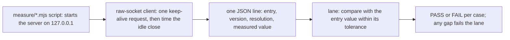

# How the defaults were measured

tripcurve's knowledge base (`src/kb/data/*.json`) holds the defaults the rules fall back on when a file does not say. Every entry states its value, the range of versions it applies to, the page or measurement it rests on, a **basis**, and a date. This page explains how the measured ones were measured, and where the method stops.

Read the limits first. Everything measured here was measured on **one laptop (macOS, darwin-arm64, Apple M5, 10 cores) with localhost connections**. No ALB, no cluster, no CI runner and no Linux host was involved; Linux values are inferred, not measured. (`docs/research.md` section 13; `docs/limits.md`, "The timed check and the demo")

## The three kinds of entry

Of the 48 entries in `src/kb/data/` (counted 2026-11-12):

| Basis | Entries | What it means |
|---|---|---|
| `measured` | 36 | a script in `measure/` started the real server on 127.0.0.1 and timed it; the lanes re-run it |
| `documented` | 9 | the vendor documents the value; the service cannot run on localhost, so there is no script, only a stated reason |
| `from-changelogs` | 3 | the old-Node `headersTimeout` entries: from changelogs and an issue thread, **not measured**, deferred |

(`src/kb/schema.ts`; the counts are from reading the JSON files.) The basis is printed beside every default in the report, for example `measured on 26.2.0` or `from changelogs, not measured`.



Text fallback: each measurement script starts the server under test on 127.0.0.1, uses a raw-socket client to send one keep-alive request and time the idle close, and prints one JSON line. The lane compares that line with the knowledge-base entry's value within the entry's tolerance and gives a PASS or FAIL per case; an entry with no script and no allowed reason is a gap and fails the lane.

## The raw-socket client

`measure/lib/idle-close.mjs` is the one shared client. It opens a plain TCP socket to 127.0.0.1, sends one `GET / HTTP/1.1` request with `Connection: keep-alive`, reads the whole response, and then times, on a monotonic clock rounded to whole milliseconds, how long the server takes to close the idle connection (the time from the last response byte to the server's FIN). (`measure/lib/idle-close.mjs`; `measure/README.md`)

It accepts only a reply it can trust. These cases are errors (exit 4, no result line), never numbers: not `HTTP/1.1 200`, a `Connection: close` reply, an ambiguous or missing `Content-Length`, bytes after the body, a reset, a server that never closes, a server that exits early, an interrupted run. (`measure/README.md`)

The server sees only its defaults: a clean environment (only `PATH`, `HOME` and `PYTHONDONTWRITEBYTECODE`), an explicit empty gunicorn config, a refusal to run when `NODE_OPTIONS` is set, a check that the reply carries `server: uvicorn`, and a version read from the running runtime, never from an argument. (`measure/README.md`)

`measure/selftest.mjs` checks the client against fake servers with known behaviour, and runs inside `npm run verify`. Its allowed slack is 15 ms above the true value and nothing below; that slack lets a bias of up to about 15 ms through, and it is kept so the test does not fail at random on a busy machine. (`measure/README.md`)

## The idle sweep, and the tolerance rule

Two different experiments appear in this project, and they must not be confused.

**The reproduction of the harm (the "6 of 26" result).** The research swept the idle gap in 4 ms steps through toxiproxy with 20 ms of injected latency, with a raw-socket client that reuses the connection unless the server's FIN has already arrived. That is what showed requests failing in the 20 ms before the idle close. It shows the mechanism; it is not an ALB measurement, and it was run on Node 22.23 and on gunicorn with uvicorn only. (`docs/research.md` section 2 and section 12)

**The measurement of a default.** The knowledge-base scripts do not sweep and inject no latency: they time the FIN directly, so the recorded resolution is `sweepStepMs: 1, injectedLatencyMs: 0`. In practice every value read 1 to 3 ms above the server's nominal setting, never below, because the client sees the response a little late and timers fire a little late. (`measure/README.md`)

**The tolerance rule.** An entry's `toleranceMs` is the largest observed deviation from the value the entry predicts, plus the resolution (`docs/limits.md`, "The measurement lanes"). Two checks keep it honest:

- The lane refuses an entry whose tolerance is finer than the script's stated resolution (`sweepStepMs` + `injectedLatencyMs` + `pollMs`), and a line that states none. The lightship script polls every 20 ms, so its first tolerance of 10 ms was below its own resolution; it was re-derived as 24 ms. (`docs/limits.md`, "The measurement lanes")
- `test/kb/tolerance-evidence.test.ts` recomputes every tolerance from the recorded result files. Only observations taken one script at a time on a quiet host count as a basis; parallel or busy runs stay in `measure/results/` as evidence only. (`docs/limits.md`, "The measurement lanes")

Resulting tolerances are small on purpose: the 16 Node entries with a script have these tolerances: 5 ms (12 entries) and 4 ms (4 entries) (counted from `src/kb/data/node-idle-close.json`, and checked by `test/docs/docs.test.ts`, which accepts any set of values), all asserted below 100 ms so that a 1 s buffer stays decidable; gunicorn's gthread explicit keep-alive is proportional (22 ms at 7 s, 138 ms at 75 s, 903 ms at 300 s) because its overshoot grows with the value; uvicorn's graceful shutdown is 214 ms; lightship's delay is 24 ms. (`docs/limits.md`, "The measurement lanes")

A narrow tolerance means a lane run on a busy machine can fail. The lane samples the load average before every case, and a run that passes on a host above half its cores prints `LANE PASS (host was busy: not an official run)` and exits 5. Official runs belong on a quiet machine. (`docs/limits.md`, "The measurement lanes"; `measure/README-lanes.md`)

## The platform

All measurements are darwin-arm64. The Node versions are official tarballs whose SHA-256 was checked against that release's `SHASUMS256.txt`; the Python versions are virtualenvs under `.cache/` (git-ignored). (`docs/research.md` section 13; `measure/README-b3-versions.md`)

Linux values are inferred, not measured. The shutdown timers (gunicorn's graceful timeout, uvicorn's) live in the servers' own code, so they are expected to match on Linux, but that is an expectation, not a measurement. (`docs/research.md` section 13; `docs/limits.md`, "The shutdown chain")

## The pinned and latest lanes

`npm run verify:measure` runs the **pinned lane**: each entry's script against the exact releases the entry cites, from `.cache/`. `node measure/lanes.mjs latest` runs the **latest lane**: it looks up the newest release of Node, gunicorn, uvicorn, uvicorn-worker and lightship with GET only, installs what is missing with its checksum or hash verified, runs the same cases, and fails when the newest release of a runtime falls outside every range of that runtime. A lookup that does not return HTTP 200 stops the lane with exit 4; it is never read as "nothing newer". The lanes never change a knowledge-base value: a difference is a finding for the maintainer. (`measure/README-lanes.md`)

Neither lane is part of `npm run verify`: they start real servers, take many minutes, and are sensitive to load. `npm run verify` runs only the lane logic against recorded lines and fakes, a gap test and a planted-drift test (`test/kb/lanes.test.ts`). (`docs/limits.md`, "The measurement lanes")

Three lane runs are on record, all on 2026-11-12. Two are the B8 runs, taken before bolt B12 added the three CloudFormation default entries. The third is the B15 release-check run, which includes them.

Verbatim from `measure/results/2026-11-12-lanes-pinned.txt` (B8, pinned lane):

```text
LANE PASS: 110 of 110 cases within tolerance, 36 entries planned, 36 entries passing, 6 carry a stated reason, 3 deferred and not measured, 0 release blockers, 0 drift findings
```

Verbatim from `measure/results/2026-11-12-lanes-latest.txt` (B8, latest lane):

```text
LANE PASS: 65 of 65 cases within tolerance, 36 entries planned, 36 entries passing, 6 carry a stated reason, 3 deferred and not measured, 0 release blockers, 0 drift findings
```

Verbatim from `measure/results/2026-11-15-lanes-latest-b26.txt` (B26, latest lane, started 06:37:26Z on 2026-11-15, no busy sample per the lane's own check, `--jobs=1`, exit 0; the newest releases found were node 26.13.1, gunicorn 27.0.1, uvicorn 0.54.0, uvicorn-worker 0.4.0 and lightship 9.1.0):

```text
LANE PASS: 65 of 65 cases within tolerance, 36 entries planned, 36 entries passing, 9 carry a stated reason, 3 deferred and not measured, 0 release blockers, 0 drift findings
```

Verbatim from `measure/results/2026-11-12-lanes-pinned-b15.txt` (B15, pinned lane, 20:27Z to 21:07Z, quiet host, exit 0):

```text
LANE PASS: 110 of 110 cases within tolerance, 36 entries planned, 36 entries passing, 9 carry a stated reason, 3 deferred and not measured, 0 release blockers, 0 drift findings
```

The B8 runs say 6 stated reasons and the B15 run says 9, because B12 added the three CloudFormation entries in between. The B15 file is classified as evidence only in `test/kb/tolerance-evidence.test.ts`: it is not a basis for any tolerance. The latest lane was run again in B26 on 2026-11-15, after B12, and is classified as evidence only in the same test; two earlier runs that day with busy samples (`2026-11-15-lanes-latest-loaded-run.*`, `LANE FAIL 61 of 65`, and `2026-11-15-lanes-latest-busy.*`, 65 of 65 but 13 busy samples) are kept as evidence and are not official runs. The lane must be run once more on the day of the go. The pre-release record is the run on the day of the maintainer's go (`docs/release-checklist.md`). What a lane run does not cover is listed in `docs/limits.md` ("What a lane run does not cover"): one run per case rather than three, the smallest explicit value of the Python entries (the largest, 300 s, only with `--full`), a K between the measured values, the interior of a version range, and platforms other than the one the lane runs on.

## Entries with no script: documented only

Nine entries carry `notMeasurableLocally` with a stated reason instead of a script (`NOT RUN` in the lane). The reason is valid only for a `documented` entry about a service that cannot run on localhost, never for a runtime the scripts can start. (`docs/limits.md`, "The measurement lanes"; `src/kb/schema.ts`)

| Entry | Stated reason (short) |
|---|---|
| `alb-idle-timeout-default` | an ALB is an AWS service; no cloud account is used |
| `k8s-grace-period-default` | applied by the API server and kubelet; no cluster is used |
| `terraform-lb-idle-timeout-default` | an ALB is an AWS service |
| `terraform-sqs-visibility-default` | an SQS queue is an AWS service |
| `terraform-lambda-timeout-default` | a Lambda function is an AWS service |
| `lambda-sqs-batching-window-default` | a Lambda event source mapping is an AWS service |
| `cfn-lb-idle-timeout-default` | an ALB is an AWS service (CloudFormation default) |
| `cfn-sqs-visibility-default` | SQS (CloudFormation default) |
| `cfn-lambda-timeout-default` | Lambda (CloudFormation default) |

(`measure/results/2026-11-12-lanes-pinned.txt` for the first six; `src/kb/data/cloudformation.json` for the last three.) The maintainer's decision names only the ALB and Kubernetes entries; the other seven go beyond its letter and await the maintainer's confirmation. (`docs/limits.md`, "The measurement lanes")

These are documented values read on the date each entry carries, with the page quoted in `docs/lookups-b5.txt` and `docs/lookups-b12.txt`. They are not measurements, and a release does not claim they are.

## Deferred entries: old Node

Three entries are **deferred and not measured**: `node-headers-trap-10x`, `node-headers-trap-12x` and `node-headers-trap-13x`. They say that on Node 10.15.2 and later 10.x, 12.x before 12.19.0 and 13.x before 13.13.0 the idle close is the smaller of `keepAliveTimeout` and `headersTimeout`. Their basis is `from changelogs, not measured`, which the rules may use for a verdict with the basis printed. The lanes print them as `DEFERRED (B13)`, count them apart and never as a pass. (`docs/research.md` section 6; `src/kb/data/node-idle-close.json`)

Why they are unmeasured: Node 10, 12 and 13 have no arm64 macOS build, and this host cannot run x64 programs because Rosetta 2 is absent (`arch -x86_64 /usr/bin/true` fails with "Bad CPU type in executable", checked 2026-11-12). Bolt B13 attempted the measurement and measured nothing; the record is `measure/results/2026-11-12-b13-attempt.txt` and `measure/README-b13.md`. Measuring them needs Rosetta 2 installed by the maintainer, or an x64 or Linux host. (`src/kb/data/node-idle-close.json`, `deferredTo.reason`)

## Dates: UTC in the records, local time in the file names

The `date` field in every result line is the UTC date (`new Date().toISOString().slice(0, 10)`). The result files carry the **local** date of the day the bolt started, and the local zone was UTC-6, so a run made late on 2026-11-11 local time is dated 2026-11-12 in its records. Example: every line of `measure/results/2026-11-11-b3-versions.jsonl` says `"date": "2026-11-12"`, and its lookup was taken at 2026-11-12T05:51Z. No result file was renamed. (`measure/README-b3-versions.md`, "Dates"; `docs/research.md` section 14)

The knowledge-base `measuredOn.date` follows the records' UTC date. Three entries, `node-idle-close-22x`, `node-idle-close-24x` and `node-idle-close-26x`, keep 2026-11-11, because the release their `measuredOn` names was measured in B0 on that date, although lower releases in their ranges were measured on 2026-11-12; one date field cannot say both. This is listed as a question for the maintainer. (`BUILD-NOTES.md`, "B10 review fixes")

## What this does not establish

- The ALB's behaviour at the idle boundary (see the limit above).
- Anything about another operating system or CPU architecture, another proxy, or an ingress controller other than the AWS Load Balancer Controller's ALB.
- The interior of a version range: each range is bracketed by measured releases, not measured release by release, and where the extra second of Node's idle close first appears between 18.20.8 and 20.20.2 was not measured. (`docs/limits.md`, "Node version ranges and the explicit idle close (B3)")
- Settings that frameworks override (Express wrappers, Fastify, Koa), `server.setTimeout`, and `connectionsCheckingInterval`. (`docs/limits.md`, same section)
- The Python event loop (uvloop and asyncio were not separated), and gunicorn's gevent, eventlet and tornado workers. (`docs/limits.md`, "Python server readers")

To add or change an entry, see [add-a-knowledge-base-entry.md](add-a-knowledge-base-entry.md).
