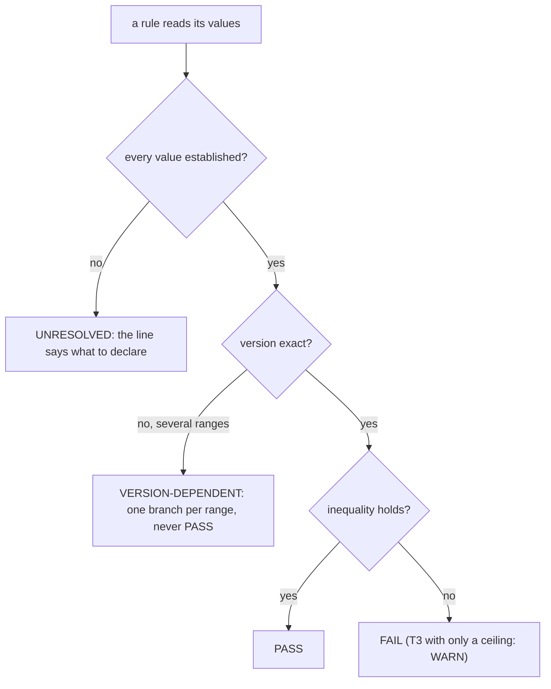

# The rules: T1 to T4

This page says what each rule requires, which vendor text it rests on, and what each result kind means for it. It follows `tripcurve --explain T1` to `T4`, whose text is shipped data in `src/evaluate/explain-entries.ts`; a test (`test/docs/docs.test.ts`) fails if a rule statement or a vendor quote here differs from that file. The knowledge-base values each rule uses are not copied here: `tripcurve --explain <rule>` prints them from the data, with their basis and date, so they cannot drift.

Dates are 2026. Every fact names its source file; a quote names the page and the date it was read.

## How to read a result

Each rule gives one of eight words per workload: PASS, FAIL, WARN, UNRESOLVED, VERSION-DEPENDENT, NOT EVALUATED, N/A or WAIVED. The honesty rule behind all of them: **a result is never PASS when any value it rests on was not established.** A value is established when it is written in a file, declared in `tripcurve.yaml`, or comes from a knowledge-base default whose basis may support a verdict:

| Basis printed | May support PASS or FAIL |
|---|---|
| `measured on <version>` | yes |
| `documented` | yes |
| `from source, not measured` | yes |
| `from changelogs, not measured` | yes, with the basis printed |
| `to be measured` | never: a placeholder, so the result is UNRESOLVED |

(`src/kb/schema.ts` `KB_BASES`; a basis of `to be measured` marks a placeholder that never supports PASS.) No entry has the basis `to be measured` today (`src/kb/data/`, checked 2026-11-12).

Text fallback: first, every value the rule needs must be established, otherwise the result is UNRESOLVED and names what to declare. Then, if the runtime version is not exact and more than one knowledge-base range remains, the result is VERSION-DEPENDENT with one branch per range, and is never PASS. Otherwise the inequality decides: PASS if it holds, FAIL if it does not (T3 gives WARN instead of FAIL when only the server's graceful-timeout ceiling, not a declared longest request, is known). N/A, NOT EVALUATED and WAIVED are described under each rule and in the README.

## T1: the application's idle close must exceed the load balancer's idle timeout

**Statement, as `--explain` prints it:** The app's effective idle close must exceed the load balancer's idle timeout. Equal is a FAIL.

**Inequality:** `idle close of the server > idle timeout of the load balancer`. (`src/evaluate/explain-entries.ts`; `src/evaluate/t1.ts`)

> We also recommend that you configure the idle timeout of your application to be larger than the idle timeout configured for the load balancer. Otherwise ... the load balancer sends an HTTP 502 Bad Gateway error to the client.
>
> Source: AWS, Application Load Balancer attributes, `https://docs.aws.amazon.com/elasticloadbalancing/latest/application/edit-load-balancer-attributes.html`, read 2026-10-29 to 2026-11-02 (research notes; `docs/research.md` section 1)

The idle close is the time after which the server closes an idle connection. It is not always the setting's value: on the Node 20, 22, 24 and 26 releases that were measured, the idle close is 1 s more than an explicit `keepAliveTimeout` (so 6 s by default, where the documented default is 5 s). These were measured (`docs/research.md` section 14). Before applying a keep-alive default, tripcurve resolves the worker model, because gunicorn's `keepalive` does nothing on the default sync worker (`docs/research.md` section 4, point e).

| Result | What it means for T1 |
|---|---|
| PASS | The load balancer idle and the server's idle close are both established, and the idle close is longer. The line names where the deciding value came from. |
| FAIL | Both are established and the idle close is not longer than the load balancer idle. |
| UNRESOLVED | Either value is not established, so nothing is claimed. Examples: the load balancer idle is only assumed (it can be changed in the console outside Git); no knowledge-base entry covers the version; an explicit `keepAliveTimeout` is outside the measured span of 7 to 65 s; the server is https (not measured); the Node source search is incomplete (a preload, `envFrom`, `--env-file`, a `createServer` argument in a form tripcurve does not read, a linked source with a syntax error, which is listed as `source-parse-error` and worded "the source could not be parsed", or a linked source with more than 500,000 syntax nodes, which is listed as `source-too-large` and worded "source too large to read safely"). The line says what to declare. (`docs/limits.md`, "Node version ranges and the explicit idle close (B3)" and "Node readers") |
| VERSION-DEPENDENT | The runtime version is not exact (a floating tag such as `node:lts`, or no tag) and more than one knowledge-base range remains. One branch is printed per range; the result is never PASS, even when every branch agrees. Pin the image tag or declare `runtime.node`. (`src/evaluate/t1.ts`) |
| N/A | The server closes every connection after each response, so the rule cannot be violated: the gunicorn sync worker, when no `-k` is given. Printed with its reason. (`docs/research.md` section 2) |

Kubernetes manifests are read as block YAML, YAML with quoted keys, YAML flow mappings (`{apiVersion: v1, kind: Pod}`) and JSON, and a `kind: List` or a list of objects at the root of a file is unwrapped, so a workload written in any of these forms gets the same T1 to T3 results. A manifest-shaped document that tripcurve cannot identify (no literal name, or an `apiVersion` that is not text) is listed under "Files not checked" and the run is not clean. (`docs/limits.md`, "A Kubernetes manifest is found by its parsed shape")

A workload for which no load balancer is found in the checked files is not a T1 result at all: it is listed as not checked, and does not by itself make a run unclean. (`src/evaluate/explain-entries.ts`)

**Old Node trap (not measured).** From Node 10.15.2 until 12.19.0 and 13.13.0, the headers timer also ran across the idle gap, so the effective idle close is the smaller of `keepAliveTimeout` and `headersTimeout`. On 10.x the default `headersTimeout` is 40 s, and on 12.x and 13.x it is 60 s. This comes from changelogs and the issue thread; it was never measured, because there is no arm64 macOS build and this host cannot run x64 programs. The three knowledge-base entries are `node-headers-trap-10x`, `node-headers-trap-12x` and `node-headers-trap-13x`, with basis `from changelogs, not measured`, and are deferred (B13). (`docs/research.md` section 6; `src/kb/data/node-idle-close.json`)

## T2: a workload behind a load balancer must delay its shutdown

**Statement, as `--explain` prints it:** A workload behind a load balancer must delay its shutdown after SIGTERM, with a preStop sleep, an in-process drain or a declared drain, so that endpoint removal can propagate before the server stops. A delay of 0 s is not a drain. (`src/evaluate/explain-entries.ts`)

> can be a simple Exec handler such as `sleep 10`
>
> Source: AWS, EKS Best Practices, Load Balancing, `https://docs.aws.amazon.com/eks/latest/best-practices/load-balancing.html`, read 2026-10-29 to 2026-11-02 (research notes; `docs/research.md` section 7)

Endpoint removal and SIGTERM happen at the same time, so no static inequality proves a rollout safe. T2 checks only that a delay exists; the propagation allowance (the guide's `sleep 10`) is printed as an assumption, not checked. (`docs/research.md` section 4, point b)

| Result | What it means for T2 |
|---|---|
| PASS | A preStop delay above 0 (`exec sleep N`, `exec /bin/sh -c sleep N`, or the `sleep` handler), an in-process drain above 0 s that was read, or a declared `drain.in_process_s` above 0 (`docs/limits.md`, "Rules T2 and T3"). |
| FAIL | None of these, and the search was complete: Node source linked and read in full, or a gunicorn or uvicorn server (where in-process drains are not read and none is declared). A Node server that imports any npm package gives UNRESOLVED rather than FAIL, because the package could drain without being handed the server. |
| UNRESOLVED | A drain exists but its duration cannot be established (a terminus `beforeShutdown` of unknown duration, a preStop hook of unknown duration), even when a preStop delay or another drain also exists; or a Node workload with no preStop whose source is not linked. |
| VERSION-DEPENDENT | Never produced by T2 in this build. |
| N/A | Never produced by T2 in this build. |

(`docs/limits.md`, "Rules T2 and T3" and "Allow-list for the Node 'no drain' claim"; `grep` of `src/evaluate` for the result kinds, 2026-11-12.)

**A difference from the research notes.** `docs/research.md` section 3 says a terminus `beforeShutdown` whose duration cannot be resolved *passes* T2 and makes T3 unresolved. That is superseded: the maintainer decided that nothing shows PASS over an unverified value, so T2 is UNRESOLVED in that case (`docs/limits.md`, "Rules T2 and T3"; `src/evaluate/explain-entries.ts`).

## T3: the grace period must cover the shutdown

**Statement, as `--explain` prints it:** terminationGracePeriodSeconds must be at least the preStop delay + the in-process drain + L + 1 s, where L is the declared longest_request_s, or else the graceful timeout of the server as a ceiling. (`src/evaluate/explain-entries.ts`)

The arithmetic is done in whole milliseconds. (`src/evaluate/explain-entries.ts`; `docs/limits.md`, "Rules T2 and T3")

> The Pod's termination grace period countdown begins before the PreStop hook is executed, ... This grace period applies to the total time it takes for both the PreStop hook to execute and for the Container to stop normally.
>
> Source: Kubernetes, container lifecycle hooks, `https://kubernetes.io/docs/concepts/containers/container-lifecycle-hooks/`, read 2026-11-12 (`measure/results/2026-11-11-lookups-b4.txt`)

> Workers still alive after the timeout (starting from the receipt of the restart signal) are force killed.
>
> Source: gunicorn, settings reference (`graceful_timeout`), `https://gunicorn.org/reference/settings/`, read 2026-11-12 (`measure/results/2026-11-11-lookups-b4.txt`)

The Kubernetes default grace period is 30 s ("The default terminationGracePeriodSeconds setting is 30 seconds.", same file). gunicorn's `graceful_timeout` ceiling is 30 s, measured on 26.2.0 and 27.0.0 for the sync worker, gthread and the uvicorn worker. uvicorn alone has no ceiling by default, and Node has none. (`docs/limits.md`, "The shutdown chain")

| Result | What it means for T3 |
|---|---|
| PASS | The grace period covers the sum. With `longest_request_s` declared, this is a pass; with only a ceiling known, it is a pass against the worst case. |
| FAIL | `longest_request_s` is declared and the grace period does not cover the sum. |
| WARN | Only the ceiling is known (no declared `longest_request_s`) and the grace period does not cover it: "workers are killed only if a request is still running (grace - preStop - drain) s after SIGTERM". A worst-case bound, not a failure. |
| UNRESOLVED | The grace period, the preStop, the drain or L is not established: a hook of unknown duration, an unlinked Node search with no declared drain, no ceiling and no declaration (every Node server, uvicorn alone, gunicorn outside what was measured). The line says to declare `longest_request_s`. |
| NOT EVALUATED | T2 failed for the workload (a drain delay is what T3 adds up). |
| VERSION-DEPENDENT | Never produced by T3 in this build. |
| N/A | Never produced by T3 in this build. |

(`docs/limits.md`, "Rules T2 and T3"; `src/evaluate/t3.ts`.) There is no global `longest_request_s`: it is declared per workload, because a global default would invite a number chosen to make T3 pass.

## T4: the queue's visibility timeout must cover the function

**Statement, as `--explain` prints it:** The visibility timeout of an SQS queue must be at least 6 x the timeout of the Lambda function that reads it + the batching window of the event source mapping. Equal passes. (`src/evaluate/explain-entries.ts`)

> We recommend setting your queue's visibility timeout to six times your Event Function timeout, plus the value of MaximumBatchingWindowInSeconds.
>
> Source: AWS, Lambda developer guide, SQS event source, `https://docs.aws.amazon.com/lambda/latest/dg/services-sqs-configure.html`, read 2026-11-12 (`docs/lookups-b5.txt`)

**T4 is not new.** It is a credited port of the cdk-nag rule `LambdaEventSourceSQSVisibilityTimeout` (added 2024-11-01, PR #1813; CDK only, without the batching window), and sits beside cfn-lint rule E3505, which validates that the visibility timeout is greater than the function's timeout (CloudFormation only, with a weaker threshold). (`docs/research.md` section 5; `tripcurve --explain T4`)

It reads a Lambda event source mapping from Terraform (HCL, JSON or a plan) or from a SAM or CloudFormation template. (`src/evaluate/explain-entries.ts`)

In Terraform source, the mapping links to its queue and function by a reference to a resource of the same folder. Terraform reads every `.tf` and `.tf.json` file of a folder as one module ("effectively treating the entire module as a single document") and treats a nested folder as a separate module, so a reference never links into a subfolder, a parent folder or a `module` block; the same address in two files of a folder, a variable, `count`, `for_each` and an override file stay UNRESOLVED. (`docs/lookups-b17.txt`; `docs/limits.md`, "The link between mapping, queue and function")

A number written as integer arithmetic on literals (`60 + (30 * 6)`) is read exactly, with only `+`, `-`, `*` and parentheses on one line, and the expression is printed beside the result. (`docs/lookups-b17.txt`; `docs/limits.md`, "Terraform")

| Result | What it means for T4 |
|---|---|
| PASS | Visibility, function timeout and batching window are all established, and visibility covers the sum. |
| FAIL | All three are established and visibility does not cover the sum. Also, when the batching window is not written or not known: visibility is below 6 x the function timeout, because a window is 0 s or more and can only raise the need (the range is 0 to 300 s; `docs/lookups-b5.txt`). The result then says the window is not set. |
| UNRESOLVED | The visibility or the function timeout is not established: a value that is not a literal, a queue or function that cannot be linked, an event source that is not an SQS queue (a Kinesis or DynamoDB stream is UNRESOLVED, not N/A). Also when visibility covers 6 x the timeout and the batching window is not written or not known: only a PASS needs the window, so the assumed 0 s is printed and never gives PASS (`docs/lookups-b5.txt`). |
| VERSION-DEPENDENT | Never produced by T4. |
| N/A | Never produced by T4. |

Defaults when an attribute is absent: SQS visibility is 30 s, Lambda timeout is 3 s, and the ALB idle is 60 s, each documented by the provider or by AWS (`docs/lookups-b5.txt`, `docs/lookups-b12.txt`). An absent batching window has no provider default, so it is the assumed 0 s: it never gives PASS or a FAIL that depends on it, and a FAIL that does not need it (visibility below 6 x the timeout) is still a FAIL (`docs/lookups-b5.txt`, "Main-session reading for B5").

## What is deliberately not a rule

`deregistrationDelay < sleep < terminationGracePeriod`, suggested in aws-load-balancer-controller #2366. AWS's own EKS guide recommends `sleep 10` against a 300 s default deregistration delay, which that inequality would flag; a rule that contradicts the vendor guide needs its own evidence, and there is none. So tripcurve does not parse the deregistration delay. (`docs/research.md` section 3)

## Waivers

A finding that is FAIL, WARN, UNRESOLVED, VERSION-DEPENDENT or NOT EVALUATED can be waived with a reason and an expiry date, inline (`# tripcurve: ignore T2 reason="drains in sidecar" until=2027-01-31`) or as a `waive:` entry in `tripcurve.yaml`. A waiver never covers PASS or N/A, never changes how a rule is computed, and expires after its date, in UTC: an expired waiver changes nothing and the finding returns. Read [security.md](security.md) before relying on waivers: a pull request can add one. (`docs/limits.md`, "Waivers and `--explain`")
